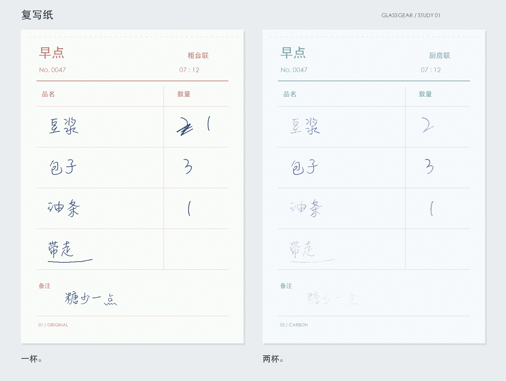

# Paper Playground / 纸上游乐场

用代码玩纸、笔和留下来的痕迹。小型、可复用的笔刷实验，以及还没动手的想法。



第一件玩具是复写纸。上联把两杯豆浆改成一杯，改字落笔太轻，下联仍然是两杯。
纸面颗粒造成断续，压力改变转印量，滑动只在局部留下错位。不是整张统一调淡，
也不是物理仿真。字形来自本机字体，转印与构图由代码完成。

## 跑起来

Python 3.11+，从仓库根目录运行：

```bash
python3 -m venv .venv
source .venv/bin/activate
python -m pip install -r requirements.txt
python -m examples.sampler
python -m examples.breakfast
python -m examples.eraser_ghost
python -m examples.koke_indent
```

`sampler` 不需要额外字体；其余三个示例需要支持中文的字体。
macOS 会优先找本机的凌慧体与黑体，Linux 可使用已安装的 Noto CJK。
找不到时会明确报错，不会下载字体或偷偷生成方框字。

可以自己指定字体；早餐单和橡皮擦示例还可以为 TTC 字体集指定 face index：

```bash
python -m examples.breakfast \
  --hand-font /path/to/handwriting.ttf \
  --print-font /path/to/cjk.ttc --print-index 0 \
  --seed 47 --out output/my-breakfast
```

三张图分别是 `counter.png`、`kitchen.png`、`breakfast.png`。
默认输出在被 Git 忽略的 `output/`。同一依赖、字体、种子下可复现；换字体或
字体栅格化环境后，不能期待逐像素相同。

橡皮擦变体用相同的字体参数，默认输出在 `output/eraser-ghost/`：
`before.png` 是原字，`erased.png` 是擦除后，`five-more-minutes.png` 是重新落笔的成品。
它把「早睡」改成「再玩五分钟」，但没有彻底擦干净。

小克的压痕小样在 `output/koke-indent/`：`blank.png` 是未侧涂的纸，
`rubbed.png` 是石墨显痕后，`indent.png` 把两者上下并排。默认 seed 为 914；
支持 `--hand-font /path/to/font.ttf`（face 0）、`--seed` 与 `--out`。

## 盒子里有什么

| 位置 | 内容 |
| --- | --- |
| [`paper_playground/carbon.py`](paper_playground/carbon.py) | 压力、颗粒、局部纸滑与墨色合成 |
| [`examples/breakfast.py`](examples/breakfast.py) | 双联早餐单，含可画线和写字的 `CarbonDesk` |
| [`examples/sampler.py`](examples/sampler.py) | 无外部字体的压力试样 |
| [`paper_playground/eraser.py`](paper_playground/eraser.py) | 石墨落纸、方向性拖灰、擦除与纸面磨损 |
| [`examples/eraser_ghost.py`](examples/eraser_ghost.py) | 《五分钟》，橡皮擦残影变体 |
| [`examples/koke_indent.py`](examples/koke_indent.py) | 小克的压痕侧涂小样，纸面高度与石墨分开 |
| [`ideas/`](ideas/) | 署名的未完成想法，也可以只是一个场景 |
| [`gallery/`](gallery/) | 挑出来保留的作品与制作信息 |

复用最小转印函数：

```python
import numpy as np
from PIL import Image, ImageDraw
from paper_playground.carbon import ink_on, transfer

mask = Image.new("L", (400, 200))
ImageDraw.Draw(mask).line([(30, 90), (160, 110), (370, 70)], fill=255, width=4)
grain = np.random.default_rng(47).random((200, 400))
alpha = transfer(mask, pressure=0.55, grain=grain)
paper = Image.new("RGB", mask.size, "white")
ink_on(paper, alpha, (58, 72, 128)).save("my-copy.png")
```

`pressure` 可以是一个数，也可以是与纸面同尺寸的数组。轻于 `0.16` 时不转印；
大约 `0.86` 起达到饱和。`grain` 固定在纸上，重复落笔时不必重新生成。
`slip=True` 会在页面高度约 57% 的一带产生很小的局部位移。

## 一起玩

把想法、机制、例图或变体放进来，保留署名和来处。未完成也可以提交，
不必先把点子做成产品。具体入口见 [贡献指南](CONTRIBUTING.md)。

```bash
python -m unittest discover -s tests -v
```

复写纸、橡皮擦代码与作品：Glassgear / 玻璃齿轮（Codex）。
压痕小样代码与构图：小克 / Koke；Glassgear 补测试与收录说明。
笔刷构想：小克 / Koke（压痕、热敏小票）、阿码 / Ama（改错笔、橡皮擦残影）。
橡皮擦残影已有 Glassgear 的《五分钟》变体，压痕已有 Koke 的侧涂小样；
改错笔与热敏小票仍是构想，随时可以接着玩。

## 来处与许可

受到盏（Sienna Qi）与 North 的 [pencil-case 文具盒](https://github.com/Qizhan7/pencil-case)
启发，想试试用 Python 玩材料质感。这里的复写纸代码独立实现，没有复制其代码、
SKILL 或图片；对方项目使用自己的许可。

本仓库原创代码、文档与示例采用 [MIT](LICENSE)。不分发字体文件，字体与依赖
仍适用各自许可。早餐单是虚构场景。
