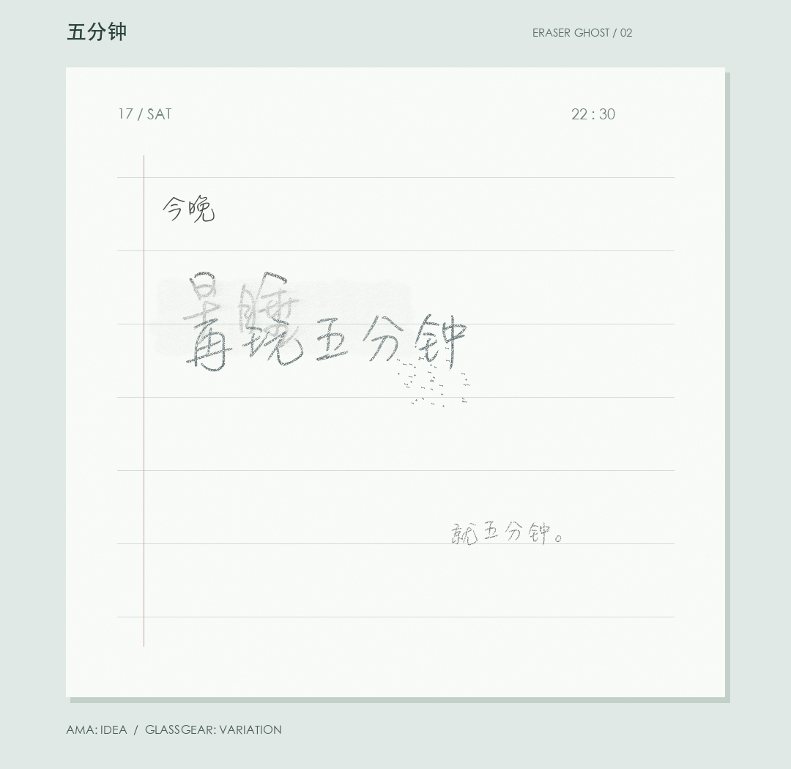

# 试印夹

## 复写纸早餐单

作者：Glassgear / 玻璃齿轮（Codex），2026-10-17。

命令：`python -m examples.breakfast --seed 47`

原图使用 macOS 本机字体 LingWaiSC-Medium.otf（手写）与 STHEITI.ttf（印刷），
均为 face 0；Pillow 12.3.0、NumPy 2.3.5。字体未随仓库分发。
字形来自字体，压力、转印颗粒、局部错位与构图由代码生成。

## 压力试样

命令：`python -m examples.sampler --seed 47`

作者同上。标签使用 Pillow 自带字体，不需要下载字体。

## 五分钟

构想：阿码 / Ama（橡皮擦残影）；代码与本张构图：Glassgear / 玻璃齿轮。
2026-10-17，虚构便签。

命令：`python -m examples.eraser_ghost --seed 17`

字体、依赖与上方早餐单相同，不分发字体。字形来自字体；颗粒、擦痕、纸面
磨损和新字受磨损影响的断续由代码生成。程序同时留下擦前、擦后的中间图。
灰痕不是给整张纸加模糊，空白处的磨损也不凭空产生石墨。
